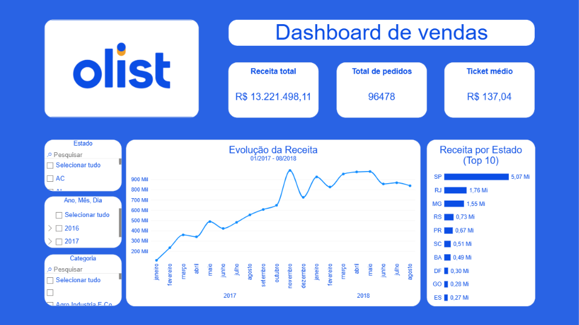
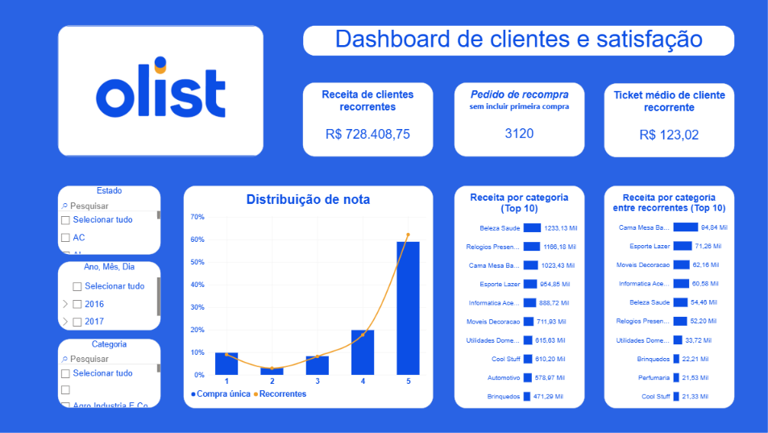

# Olist: Vendas e Retenção de Clientes

Bem vindo ao meu portfolio!
Nesse projeto foi realizada uma análise no e-commerce brasileiro Olist com **MySQL**, importando os registros do dataset pelo HeidiSQL, desenvolvendo perguntas de negócio e insights junto as queries, para então criar duas páginas no dashboard com **Power BI**: uma visão executiva de vendas e uma investigação sobre a baixa recompra dos clientes.

## Pergunta de negócio

> A Olist vende bem, mas **por que tão poucos clientes voltam a comprar?** A experiência (nota de avaliação) e as categorias de produto explicam isso?

## Perguntas respondidas em SQL

1. Qual a receita, o número de vendas e o ticket médio?
2. Quais estados geram mais receita, com pedidos e ticket médio?
3. Qual a receita mensal e a variação em relação ao mês anterior?
4. Quantos pedidos foram de recompra?
5. Como se distribuem as notas entre clientes de compra única e recorrentes?
6. Quais categorias mais geram receita no geral e entre os recorrentes?

Cada query tem um comentário com a resposta e a interpretação de negócio.

## Principais achados

- **Receita de R$ 13,2 milhões**, em 96478 pedidos entregues, com ticket médio de **R$ 137,04** (considerando só o preço dos produtos, sem frete).
- **Concentração geográfica:** SP responde por cerca de 38% da receita (R$ 5,07 mi), seguido de RJ (R$ 1,76 mi) e MG (R$ 1,55 mi).
- **Sazonalidade:** a receita cresceu 52% em novembro de 2017 (Black Friday), seguida de uma normalização em dezembro.
- **Recompra é rara:** apenas **3120 pedidos** dos 96478 vieram de clientes que já tinham comprado antes.
- **A nota não explica a baixa recompra:** Algo que me pegou de surpresa. 62% dos clientes recorrentes deram nota 5, contra 59% dos clientes de compra única. A diferença é pequena. O motivo da recompra deve estar ligado a outros fatores.
- **Categorias:** `cama_mesa_banho` e `esporte_lazer` estão entre as que mais geram receita tanto no geral quanto entre os recorrentes, o que as torna um ponto de partida para ações de retenção.

## Porque isso é importante?
Se conseguirmos identificar oque causa retenção de clientes e as recompras, poderemos repetir esse padrão e ter um impacto maior na receita geral.

## Dashboard

### Página 1: Visão geral de vendas


### Página 2: Clientes e satisfação


## Ferramentas

- **MySQL:** modelagem das tabelas e análise exploratória (CTEs, window functions e views).
- **Power BI:** construção do dashboard interativo, com filtros por estado, período e categoria.

## Decisões e limitações

- **Só pedidos com status `delivered`** foram considerados.
- **Receita sem frete:** usa `price` da tabela de itens, e não `freight_value`, considerando apenas o valor bruto dos produtos.
- **Período:** o dashboard cobre 01/2017 a 08/2018. Os meses de 2016 e o fim de 2018 têm poucos pedidos e distorceriam as comparações.
- **Cliente recorrente:** identificado por `customer_unique_id`, porque o `customer_id` muda a cada pedido.
- **Tabela `geolocation` não utilizada**, pois a análise não depende de coordenadas.
- **Sem chaves estrangeiras no MySQL:** o banco foi usado apenas para responder perguntas de negócio, então as relações foram omitidas de propósito.
- **Base recorrente pequena (~3%):** diferenças entre os dois grupos, como a das notas, devem ser lidas com cautela.

## Estrutura do repositório

```
Portfolio-analise-Olist/
├── README.md
├── sql/
│   ├── 01_criacao_tabelas.sql
│   └── 02_queries_negocio.sql
├── powerbi/
│   └── Dashboard.pbix
└── imagens/
    ├── pagina1_vendas.png
    └── pagina2_clientes.png
```

## Como reproduzir

1. Baixe o dataset no Kaggle: [Brazilian E-Commerce Public Dataset by Olist](https://www.kaggle.com/datasets/olistbr/brazilian-ecommerce).
2. No MySQL, execute `sql/01_criacao_tabelas.sql` e importe os CSVs nas tabelas criadas.
3. Execute `sql/02_queries_negocio.sql` para obter as análises.
4. Abra `powerbi/Dashboard.pbix` no Power BI Desktop.

## Créditos

Dataset público disponibilizado pela **Olist** no Kaggle, sob licença CC BY-NC-SA 4.0. Os dados não são redistribuídos neste repositório.

## Autor: Guilherme Antônio de Souza

(Excel | SQL | Power BI | Python)

[LinkedIn](https://www.linkedin.com/in/guilherme-souza-aab746414) · [guilhermeant.tech@gmail.com]
